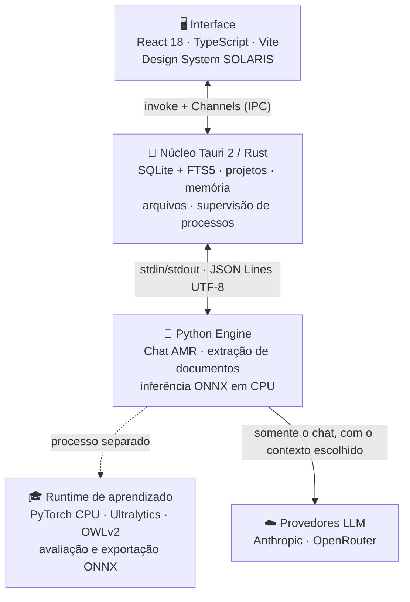

<div align="center">

# ☀️ SOLARIS

### Sua plataforma pessoal de Inteligência Artificial — projetos, chat multi-LLM, memória viva e visão computacional, tudo em um app desktop

**Organize seu trabalho em projetos, converse com os melhores modelos de IA usando os seus próprios arquivos como contexto e ensine o computador a reconhecer o seu ambiente — com privacidade, rodando no seu PC.**

<!-- Versão e plataforma -->

[](https://github.com/CFSJCODE/Solaris/releases)


-F88F22?style=for-the-badge>)


<!-- Núcleo do aplicativo -->


<!-- IA e visão computacional -->


-111F68?style=flat-square&logo=ultralytics&logoColor=white>)

-FFD21E?style=flat-square&logo=huggingface&logoColor=black>)

<!-- Qualidade de código -->


</div>

---

## ✨ Por que o SOLARIS

A maioria das ferramentas de IA esquece tudo a cada conversa, mistura assuntos e exige enviar seus dados para a nuvem. O SOLARIS foi criado para o oposto:

- 🗂️ **Projetos de verdade.** Cada projeto tem suas conversas, arquivos, instruções e memória — sem misturar contextos.
- 🧠 **Memória que persiste.** Decisões e informações importantes viram documentos Markdown versionados, que a IA relê antes de cada resposta.
- 🔀 **O melhor modelo para cada pergunta.** Um roteador escolhe entre Claude (Anthropic) e modelos do OpenRouter, com _fallback_ automático se um provedor falhar.
- 👁️ **Visão computacional local.** Detecção de objetos ao vivo pela câmera, rodando no seu processador — as imagens nunca saem do seu PC.
- 🎓 **Aprende com você.** Você marca objetos novos na tela e o SOLARIS treina, avalia e só ativa um modelo melhor quando a avaliação comprova.
- 🔒 **Privacidade por padrão.** Credenciais ficam na sua pasta de dados, nunca no instalador; a visão é 100% local.

---

## 🚀 Recursos

### 🗂️ Projetos como espaços de trabalho

- Crie projetos com objetivo e instruções próprias; fixe os favoritos.
- Adicione **PDF, DOCX, Markdown, TXT e código** — o texto é extraído e indexado localmente.
- Busca textual **FTS5** isolada por projeto: a IA consulta os trechos relevantes dos seus arquivos.
- **Fontes consultadas** em cada resposta, preservadas no histórico — você sempre sabe de onde veio a informação.

### 💬 Chat multi-LLM inteligente

- **Roteamento adaptativo (AMR):** perguntas simples vão para modelos rápidos e econômicos; tarefas complexas, para modelos mais capazes.
- **Streaming** da resposta em tempo real, com renderização de Markdown (tabelas, listas, código).
- **Controle de custos:** tokens e custo em US$ de cada resposta, por modelo e provedor.
- **Circuit breaker:** se o provedor principal falhar, o SOLARIS tenta automaticamente o alternativo.

### 🧠 Memória viva em Markdown

- Cada projeto mantém `AGENTS.md`, `README.md`, `MEMORY.md`, `DECISOES.md` e `CONTRIBUTING.md` próprios, editáveis na interface.
- Histórico de versões com recuperação; nada é sobrescrito sem registro.
- Pedidos como "salve isso na memória" só são confirmados **depois** da gravação efetiva, com recibo na conversa.

### 👁️ Visão computacional e aprendizado ativo

- Detecção ao vivo com **YOLO26** (modelo grande pré-carregado na inicialização; modelo leve para tempo real), com as 80 classes COCO **em português**.
- **Pausar e revisar quadro:** desenhe, mova e nomeie caixas sobre o quadro congelado para ensinar objetos novos.
- **Aprendizado ativo em segundo plano:** seleção de exemplos úteis, verificação com YOLO26x + OWLv2 e ByteTrack, treino em processo CPU separado com limites de memória, carga e disco.
- **Proteção contra regressão:** uma candidata só substitui o modelo ativo se não piorar as classes que ele já reconhece; classes novas podem entrar como **complemento provisório isolado**, com aviso claro de que a generalização ainda não foi comprovada.
- **Contexto do ambiente:** hipóteses como "escritório" ou "quarto" ajudam a investigar objetos esperados, sem inventar detecções.

---

## 🏗️ Arquitetura

O SOLARIS é um **app desktop sem servidor**: não há HTTP, portas abertas, Docker ou banco externo. A interface conversa com o núcleo Rust por IPC, e o Rust conversa com o motor Python por pipes **JSON Lines**.



| Camada          | Tecnologias                            | Responsabilidade                                                 |
| --------------- | -------------------------------------- | ---------------------------------------------------------------- |
| **Interface**   | React 18, TypeScript, Vite             | Projetos, chat, visão, revisão gráfica                           |
| **Núcleo**      | Tauri 2, Rust, SQLite + FTS5           | Persistência, memória, arquivos, IPC, ciclo de vida do engine    |
| **Engine**      | Python, ONNX Runtime, OpenCV           | Chat multi-LLM, documentos, inferência de visão                  |
| **Aprendizado** | PyTorch CPU, Ultralytics YOLO26, OWLv2 | Verificação, treino, avaliação, exportação e promoção de modelos |

**Princípios:** processamento local sempre que possível · nenhum dado de visão enviado a APIs · credenciais fora do instalador e do Git · versões de modelo preservadas com SHA-256 e reversão em caso de falha.

---

## 🎨 Design System SOLARIS

Identidade visual própria, inspirada em Fluent UI, WinUI e Liquid Glass, com a paleta **Sunset**:

|                                    Ember                                     |                                    Flare                                     |                                     Gold                                     |                                     Glow                                     |
| :--------------------------------------------------------------------------: | :--------------------------------------------------------------------------: | :--------------------------------------------------------------------------: | :--------------------------------------------------------------------------: |
|  |  |  |  |

Gradientes contínuos, superfícies com profundidade e animações fluidas — tudo a partir de tokens `--sol-*`.

---

## 🔐 Privacidade e segurança

- **Visão 100% local:** quadros e modelos ficam no seu computador.
- **Chat sob seu controle:** só os trechos, instruções e histórico da conversa são enviados ao provedor que você configurou.
- **Credenciais protegidas:** ficam em `%APPDATA%\com.cfsjcode.solaris\.env` — nunca no instalador, no Git ou nos logs.
- **Sem execução de instruções vindas de arquivos:** documentos importados são tratados como dados, não como comandos.

---

## 📦 Instalação

1. Baixe e execute o instalador `Solaris_<versão>_x64_en-US.msi`.
2. Crie o arquivo `%APPDATA%\com.cfsjcode.solaris\.env` com as suas chaves:

   ```env
   ANTHROPIC_API_KEY=...
   ANTHROPIC_WORKSPACE_ID=...   # se a sua chave for de workspace
   OPENROUTER_API_KEY=...
   ```

3. Abra o SOLARIS pelo Menu Iniciar.

> Requisitos: Windows 10/11 x64 e WebView2. Não exige GPU — a visão roda em CPU.

---

## 🛠️ Desenvolvimento

**Pré-requisitos:** Node.js 20+, Rust estável, Python 3.12+ (engine) e Visual Studio C++ Build Tools.

```powershell
# Frontend
npm --prefix frontend install
npm --prefix frontend run build

# Engine Python
python -m venv python-engine/.venv
python-engine/.venv/Scripts/pip install -r python-engine/requirements.txt -r python-engine/requirements-dev.txt

# Testes
python-engine/.venv/Scripts/python -m unittest discover -s python-engine/tests
cargo test --manifest-path src-tauri/Cargo.toml

# Instalador (engine + MSI)
./scripts/build.ps1
```

**Qualidade de código:** `npm run format` (Prettier) · `python -m ruff format . && python -m ruff check .` (Ruff) · `npx pyright` · `cargo fmt` (rustfmt).

Antes de mudanças relevantes, leia [AGENTS.md](AGENTS.md), [CONTRIBUTING.md](CONTRIBUTING.md), [MEMORY.md](MEMORY.md) e [DECISOES.md](DECISOES.md).

---

## 📚 Documentação

- [Visão computacional](docs/visao.md)
- [Aprendizado autônomo](docs/aprendizado-autonomo.md)
- [Revisão gráfica de quadros](docs/revisao-quadros.md)
- [Entrega e validação](docs/entrega-0.5.0.md)
- [Conceitos matemáticos aplicados](docs/conceitos-matematicos-aplicados.md)

---

## 🗺️ Status e roadmap

O SOLARIS está em **desenvolvimento ativo** (série 0.5). Já entregue: projetos, chat multi-LLM com roteamento e custos, memória Markdown, busca FTS5, visão ao vivo e ciclo completo de aprendizado ativo com proteção contra regressão.

**Próximos passos:** OCR para PDFs digitalizados · busca semântica por embeddings · tela de configurações para as chaves de API · validação de melhorias reais de precisão com a câmera · descoberta de objetos além do vocabulário definido.

> **Transparência:** o aprendizado ativo está implementado e protegido por avaliação, mas uma melhora real de precisão no ambiente ainda não foi demonstrada. Métricas e limites de cada entrega estão em [docs/entrega-0.5.0.md](docs/entrega-0.5.0.md).

---

<div align="center">

Feito com ☀️ por **[CFSJCODE](https://github.com/CFSJCODE)**

</div>
